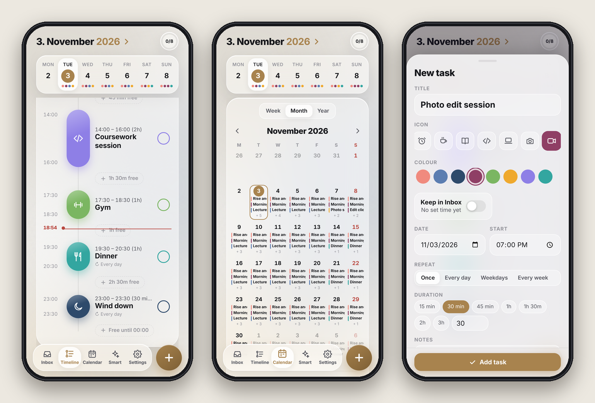
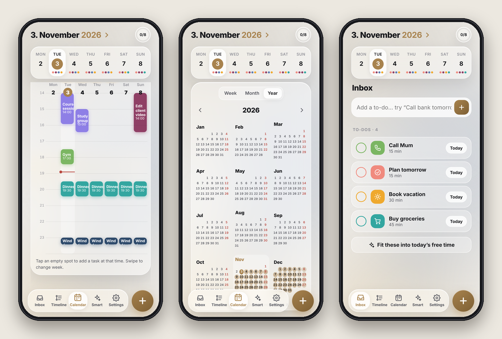
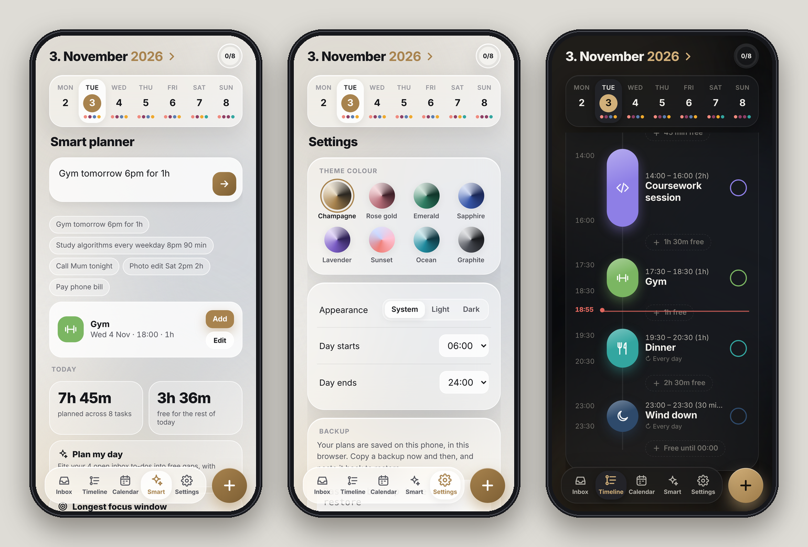
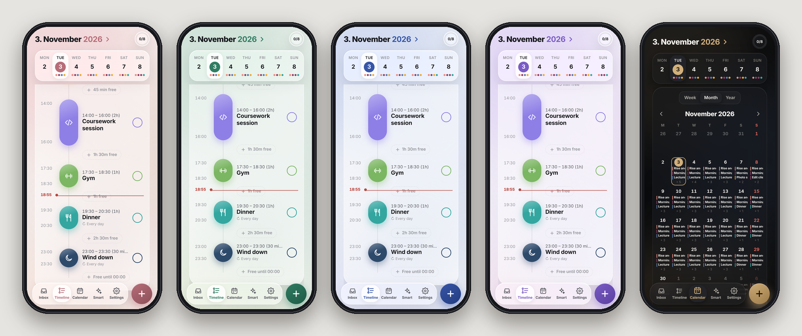

# Glassday

A personal day planner for iPhone with a frosted-glass interface, a visual daily timeline, and two-way sync with Apple Calendar. It includes home-screen widgets that show your month at a glance.

Glassday is built as a SwiftUI shell around a hand-written HTML/CSS/JS interface. A small native bridge connects that interface to EventKit (Apple Calendar) and WidgetKit.

<p align="center">
  
</p>

---

## Features

### Planning
- **Timeline**: your day as a vertical timeline.
  - Pill heights scale with each task's duration.
  - A live "now" line and an "Xm remaining" progress fill show where you are.
  - Free gaps between tasks appear as chips you can tap to fill.
- **Calendar tab** with three views:
  - **Week**: a time grid. Tap an empty slot to add at that time.
  - **Month**: a grid with event bars. Tap a day to see its events below the grid, tap again to open it.
  - **Year**: all 12 months, shaded by how busy each day is.
- **Inbox**: to-dos with no time yet. Your top inbox items also appear as quick bubbles at the top of the Timeline.
- **Overdue**: missed tasks are collected with a one-tap *Move to today*.
- **All-day and multi-day events**: holidays, trips and deadlines sit in their own strip at the top of the Timeline, and as spanning bars at the top of Week and Month. They never overlap timed tasks. Type `Penang trip Fri to Sun` or `Hackathon 12/11 to 14/11` and Glassday makes it all-day.
- **Repeating tasks**: every day, weekdays, every week, every month or every year. Deleting a repeat asks whether to remove **this one only**, **this and all future ones**, or **all of them**.
- **Overlap warnings** when you schedule over another task.

### Phone-friendly task editor
- **Starts → Ends** times. On iPhone these open the native time wheel; on a computer you can type.
- **Duration wheel**: scroll hours and minutes like the iPhone Timer, with a light haptic tick on each step. Quick buttons cover the usual lengths (15 min to 2h).
- Start, End and Duration stay in sync. Change any one and the others follow.
- **Steady panel**: the title and Save button stay pinned while only the middle scrolls. The panel rises above the keyboard instead of pushing the screen, and you drag the top bar down to close it.

<p align="center">
  
  <br><sub>Week view · Year view · Inbox</sub>
</p>

### Smart helpers (on-device, no AI service)
- **Natural-language add**: type `Gym tomorrow 6pm for 1h` or `Study every weekday 8pm 90 min`. Glassday picks out the date, time, duration and repeat, and chooses an icon.
- **Plan my day**: fits your inbox to-dos into free gaps, with 10-minute breaks between them.
- **Insights**: planned vs free time, your longest focus window, a completion streak, and a week-load chart.

### Focus
- Tap any task's icon to start a **focus timer** with a countdown ring.
- The screen stays awake while the timer runs.

<p align="center">
  
  <br><sub>Smart planner · Settings with theme colours · Dark mode</sub>
</p>

### Look and feel
- Glassmorphism UI with ambient animated colour blobs.
- **8 theme colours**: Champagne, Rose gold, Emerald, Sapphire, Lavender, Ocean, Sunset and Graphite. Each has its own light and dark version.
- Spring animations, a confetti burst when you complete a task, swipe gestures and native haptics.
- Undo for most actions.

<p align="center">
  
  <br><sub>Rose gold · Emerald · Sapphire · Lavender · Champagne (dark)</sub>
</p>

### iPhone integration
- **Two-way Apple Calendar sync**:
  - Scheduled tasks are real calendar events.
  - Changes made in Apple Calendar, or in Google/Outlook accounts added to iOS, appear in Glassday instantly.
- **Widgets**:
  - **Month** (large): Sunday-first month grid with event bars. Tap a day to open it in the app.
  - **Today** (small / medium): what's next today.
- **Deep links**: `glassday://day/YYYY-MM-DD` opens a specific day.

---

## Tech stack

| Layer | Technology |
|---|---|
| UI | Vanilla HTML, CSS and JavaScript in a single file (no framework, no build step) |
| App shell | SwiftUI and `WKWebView` (iOS 17+) |
| Calendar | EventKit (full-access API) |
| Widgets | WidgetKit and SwiftUI |
| Project generation | [XcodeGen](https://github.com/yonaskolb/XcodeGen) |
| Fonts | Bricolage Grotesque and Manrope (Google Fonts) |

---

## Project structure

```
Glassday/
├── project.yml                 # XcodeGen spec (targets, bundle IDs, Info.plist keys)
├── setup.sh                    # Installs XcodeGen if needed, generates and opens the project
├── build-ipa.sh                # Builds Glassday.ipa (app + widget) for Sideloadly / AltStore
├── docs/screenshots/           # Images used in this README
├── App/
│   ├── GlassdayApp.swift       # App entry point
│   ├── ContentView.swift       # WKWebView host, deep links, keyboard handling
│   ├── CalendarBridge.swift    # JS ⇄ EventKit bridge, haptics, persistence
│   ├── Resources/
│   │   └── index.html          # The whole Glassday interface
│   └── Assets.xcassets/        # App icon
└── Widget/
    └── GlassdayWidgets.swift   # Month + Today widgets
```

---

## How it works

```
┌──────────────────────────┐      postMessage       ┌──────────────────────┐
│  index.html (WKWebView)  │ ─────────────────────▶ │   CalendarBridge     │
│  UI, local state         │                        │   (Swift)            │
│                          │ ◀───────────────────── │                      │
└──────────────────────────┘   evaluateJavaScript   └──────────┬───────────┘
                                 (GDN.* callbacks)              │ EventKit
                                                                ▼
                         ┌───────────────────┐       ┌────────────────────┐
                         │  Widget extension │ ◀──── │   Apple Calendar   │
                         │  (reads EventKit) │       │   (source of truth │
                         └───────────────────┘       │    for events)     │
                                                     └────────────────────┘
```

### Where data lives
- **Scheduled tasks** are Apple Calendar events. Calendar is the source of truth for them.
- **Kept in the app** (saved in `UserDefaults`):
  - inbox to-dos,
  - per-event icons and colours,
  - completion ticks,
  - settings.

### Bridge messages (page → native)

| `type` | Payload | Purpose |
|---|---|---|
| `ready` | | Page loaded; flush any pending deep link |
| `access` | | Request or confirm calendar access |
| `load` | `from`, `to` (YYYY-MM-DD) | Fetch events in a date window |
| `upsert` | `reqId`, `series?`, `occDate?`, `title`, `date`, `start`, `dur`, `repeat`, `notes`, `calId` | Create or update an event |
| `delete` | `series`, `occDate`, `span` (`one`/`future`) | Remove an event |
| `persist` | `data` (JSON string) | Save app-only state |
| `haptic` | `style` (`light`/`medium`/`success`) | Haptic feedback |
| `awake` | `on` | Keep the screen awake during focus |

### Native → page callbacks
`GDN.access(status)`, `GDN.calendars(list, defaultId)`, `GDN.events(list, from, to)`, `GDN.saved(reqId, id, error)`, `GDN.openDay(key)`, `GDkb(keyboardHeight)`

### Rules for recurring and read-only events
- Edits to a recurring event apply to **this and future** occurrences.
- Events from read-only calendars (holidays, subscriptions) can't be moved. You can still give them an icon and colour.

The interface also runs in a normal browser. Without the bridge it falls back to `localStorage` with sample data, which makes UI work quick to iterate on.

---

## Getting started

### Requirements
- A Mac with **Xcode 15+**
- An iPhone on **iOS 17+**
- An Apple ID (a free account works)

### Setup
```bash
# 1. Homebrew (skip if `brew --version` works)
/bin/bash -c "$(curl -fsSL https://raw.githubusercontent.com/Homebrew/install/HEAD/install.sh)"
echo 'eval "$(/opt/homebrew/bin/brew shellenv)"' >> ~/.zprofile
eval "$(/opt/homebrew/bin/brew shellenv)"

# 2. Point to Xcode and install XcodeGen
sudo xcode-select -s /Applications/Xcode.app/Contents/Developer
sudo xcodebuild -license accept
brew install xcodegen

# 3. Clone, generate, open
git clone https://github.com/<your-username>/Glassday.git
cd Glassday
xcodegen generate
open Glassday.xcodeproj
```

### Run on your iPhone
1. **Xcode → Settings → Accounts**: sign in with your Apple ID.
2. Select the **Glassday** project.
3. For **both** targets (`Glassday` and `GlassdayWidget`), go to **Signing & Capabilities** and set **Team** to your Personal Team.
   - If the bundle ID is taken, change `com.geraldangya` in `project.yml` (or in Xcode) to your own prefix.
4. On your iPhone, turn on **Settings → Privacy & Security → Developer Mode** and restart when asked.
5. Plug in your phone, select it as the run destination, and press **▶ Run**.
6. If prompted, go to **Settings → General → VPN & Device Management** on the phone and trust your developer profile.
7. Open Glassday and allow **Full Access** to Calendar.
8. Add the widget: long-press the home screen, then **Edit → Add Widget → Glassday**.

> **Free Apple ID:** apps signed with a free account expire after **7 days**. Re-run from Xcode to renew; your data stays. To renew automatically instead, use the free Sideloadly method below.

### Free install with automatic renewal (Sideloadly)
This keeps Apple Calendar sync and the widgets, costs nothing, and renews the app over Wi-Fi so you don't have to plug in every week.

1. Build the app package:
   ```bash
   ./build-ipa.sh
   ```
   This creates `Glassday.ipa` with the app and widget inside.
2. Install [Sideloadly](https://sideloadly.io) on your Mac. The first time, open it with right-click → **Open**.
3. Plug in your iPhone, unlock it, and tap **Trust**. In Finder, select the iPhone, tick **Show this iPhone when on Wi-Fi**, and click **Apply**.
4. In Sideloadly:
   - drag in `Glassday.ipa`,
   - enter your Apple ID,
   - leave **Use automatic bundle ID** on and **Dropping 0 of 1 plug-ins** at 0 (that plug-in is the widget),
   - turn on **automatic refresh** (the circular-arrows button),
   - click **Start**.
5. On the iPhone, go to **Settings → General → VPN & Device Management**, tap your Apple ID, and **Trust** it.
6. Keep Sideloadly's helper running on the Mac (add it to **Login Items**). The app renews whenever the phone and Mac share Wi-Fi with the Mac awake, at least once every 7 days.

**Free account limits**
- **3 sideloaded apps** at once. Glassday and its widget use two of those slots.
- **10 new App IDs every 7 days.** Updating or renewing Glassday reuses its App ID, so it doesn't count against this.

**Updating:** run `./build-ipa.sh` again, drag the new `Glassday.ipa` into Sideloadly, and click **Start**. The app updates in place and keeps your data.

**A second iPhone:** select it under *iDevice* in Sideloadly and install the same way. Each phone has its own 7-day timer. Inbox to-dos, icons and ticks stay on each phone, so move them with **Settings → Copy backup / Restore**.

> **Security tip:** you can use a separate free Apple ID just for signing. Calendar sync uses the iCloud account signed in on the phone, so it isn't affected.

### Working on the UI
The whole interface is in `App/Resources/index.html`. You can open it directly in a browser to iterate, then press **▶ Run** in Xcode to test it on the phone.

---

## Roadmap ideas
- [ ] Widget follows the selected theme colour (via an App Group)
- [ ] Apple Reminders sync for inbox to-dos
- [ ] Notifications before tasks start
- [ ] Interactive widget checkboxes (iOS 17 App Intents)
- [ ] Bundle fonts locally for full offline use
- [x] Start/end times and a duration scroll wheel
- [x] Steady task panel that works with the iPhone keyboard
- [x] Free install with automatic renewal (Sideloadly)

---

## License
MIT. Use it, learn from it, and make it yours.
